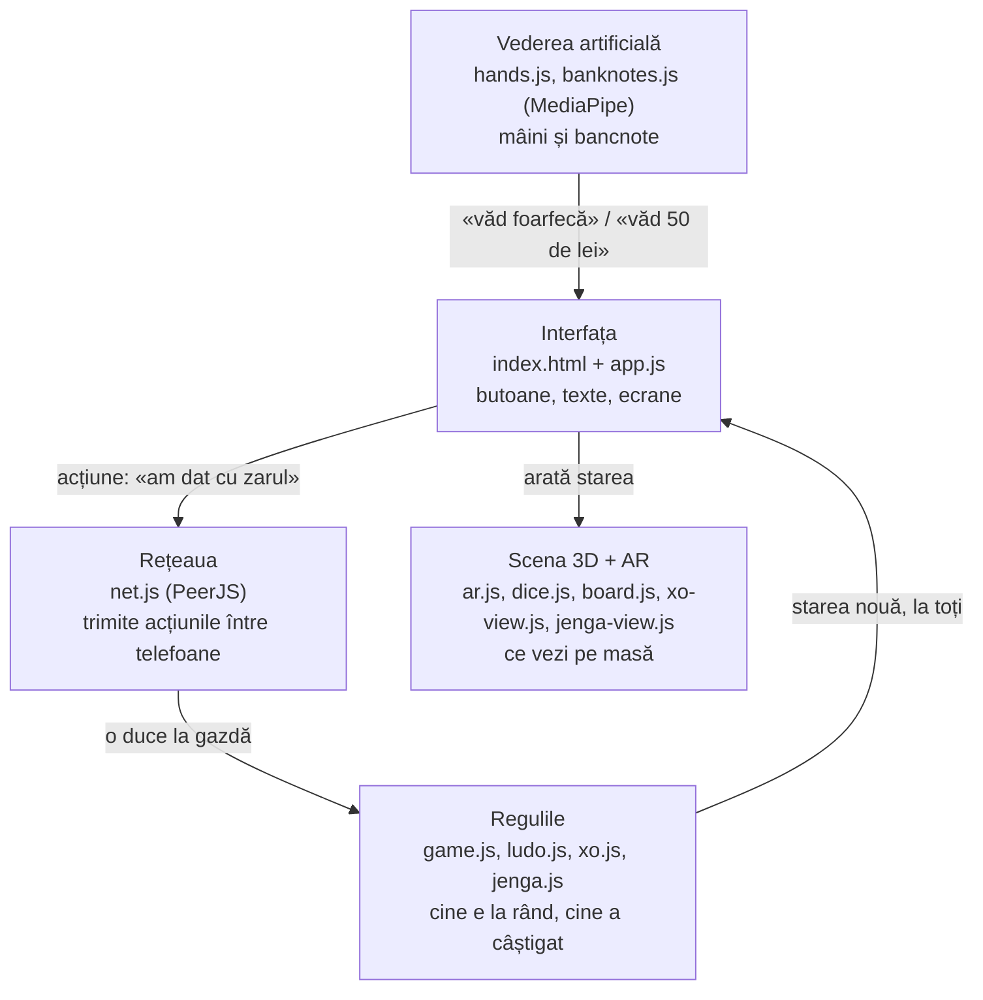

# Cum e făcut Camera Arcade AR

Ghid pentru programatorul care a construit asta cu AI („vibe coding”) și vrea să știe ce face fiecare bucată și de ce e făcută așa. Citește-l de sus în jos o dată, apoi folosește-l ca hartă când deschizi fișierele.

> Pe scurt: e o **pagină web** (fără server propriu, fără build). Telefonul descarcă câteva fișiere JavaScript, pornește camera, desenează lucruri 3D peste imaginea camerei și vorbește direct cu telefoanele prietenilor.

---

## 1. Ideea mare, în 30 de secunde

Aplicația are patru „straturi”, fiecare cu treaba lui:



Regula de aur a proiectului: **regulile nu știu nimic despre ecran, iar ecranul nu decide nimic despre reguli.** De-asta regulile se pot testa automat fără telefon (vezi secțiunea 9).

---

## 2. Cum îl pornești pe calculatorul tău

Nu există `npm install` și nici build. Ai nevoie doar de un server care să servească fișierele:

```bash
npx serve .
```

Deschizi adresa afișată (de obicei http://localhost:3000). Aplicația cere camera la pornire; fără cameră (ex.: un laptop fără webcam) adaugă `?screen` în adresă pentru vederea 3D de test. Camera merge pe `localhost` din browserul de pe laptop. Pe telefon, browserul cere **HTTPS** pentru cameră, așa că acolo testezi pe varianta publicată: https://camera-arcade-ar.vercel.app (Vercel o republică singur la fiecare `git push` pe `main`).

### De unde vin bibliotecile?

Din CDN (jsDelivr), cu versiunea fixată, ca să nu se strice peste noapte. În `index.html` e un **import map**: o listă care îi spune browserului „când un fișier scrie `import ... from 'three'`, adu-l de la adresa asta”.

| Bibliotecă | La ce folosește |
|---|---|
| three.js | desenează 3D (zaruri, tabla, turnul) |
| cannon-es | fizica: zarurile cad, se lovesc, se rostogolesc |
| PeerJS | legătura directă între telefoane (WebRTC) |
| MediaPipe Tasks Vision | rețele neuronale Google: mâini și „amprenta” imaginilor |
| AlvaAR | SLAM: înțelege cum se mișcă telefonul față de masă (pe iPhone) |
| js-aruco2 | recunoaște markerul printat |
| Iconify (Phosphor) + fontul Inter | iconițele și fontul interfeței |

---

## 3. Harta fișierelor

| Fișier | Strat | Ce face, pe românește |
|---|---|---|
| `index.html` | interfață | toate ecranele (nume, lobby, joc) și stilurile (CSS) |
| `app.js` | interfață | „dirijorul”: ascultă butoanele, trimite acțiuni, arată starea, pornește scena și camera |
| `game.js` | reguli | starea camerei de joc și regulile la zaruri, PHF, plus „creierul” calculatorului |
| `ludo.js` | reguli | regulile „Nu te supăra, frate” |
| `xo.js` | reguli | X și 0 + calculatorul |
| `jenga.js` | reguli | turnul Jenga: ce piese poți trage, dacă turnul mai stă, prăbușirea |
| `net.js` | rețea | creează / intră într-o cameră online, trimite starea |
| `ar.js` | scenă | cele 4 moduri de a pune jocul: ecran, WebXR, SLAM, marker |
| `dice.js` | scenă | zarurile 3D cu fizică |
| `board.js` | scenă | tabla 3D de Ludo și pionii |
| `xo-view.js`, `jenga-view.js` | scenă | tabla de X și 0, turnul Jenga |
| `hands.js` | vedere | găsește mâinile și zice ce gest e |
| `banknotes.js`, `banknote-refs.json` | vedere | recunoaște bancnotele |
| `marker.html` | — | pagina cu markerul de printat |
| `tests/` | — | testele automate |

---

## 4. Drumul unei acțiuni: ce se întâmplă când apeși „Aruncă”

Hai să urmărim un singur click, cap-coadă. E cel mai bun mod de a înțelege tot proiectul.

1. **`app.js` → `mainAction()`**: verifici că e rândul tău, apoi se aleg două valori de zar cu `crypto.getRandomValues` (aleatoriu „adevărat”, nu pseudo).
2. Se trimite o **acțiune**, adică un mic obiect: `{ type: 'roll', values: [4, 2] }`.
3. **`net.js`**: dacă tu ești gazda, acțiunea merge direct la reguli. Dacă nu, pleacă prin internet la telefonul gazdei.
4. **`game.js` → `reduce(stare, acțiune, cine)`**: gazda calculează **starea nouă** („Ana a dat 4+2; e rândul lui Mihai”). Dacă acțiunea nu e permisă (nu e rândul tău, valori trucate), e ignorată.
5. Gazda trimite starea nouă **tuturor** telefoanelor.
6. **`app.js` → `render()`**: fiecare telefon primește starea și o arată: textele, scorurile, butonul.
7. **`dice.js`**: zarurile se rostogolesc pe ecranul fiecăruia și cad **exact** pe 4 și 2. Cum se face asta, vezi secțiunea 6.

### De ce așa? Conceptul de *reducer*

`reduce` e o funcție „pură”: primește starea veche și o acțiune și întoarce o stare nouă. Nu atinge ecranul, nu atinge rețeaua și dă mereu același rezultat pentru aceleași date. Avantaje:

- **Un singur arbitru.** Doar gazda rulează regulile, deci nu pot exista două versiuni ale adevărului pe telefoane diferite.
- **Anti-trișat de bază.** Un jucător trimite doar *intenția* („vreau să mut pionul 2”), iar gazda decide dacă e voie.
- **Se testează ușor.** Un test e doar: „stare + acțiune → mă aștept la starea X”.

Calculatorul (bot-ul) și cronometrele (de exemplu numărătoarea la PHF) sunt în `hostTimers()` din `game.js`. Gazda îl apelează de 5 ori pe secundă și primește înapoi acțiunile pe care „ar face-o” calculatorul. Bot-ul trece deci prin aceleași reguli ca un om.

---

## 5. Multiplayer fără server: `net.js`

**WebRTC** e tehnologia din browser pentru apeluri video: două telefoane vorbesc **direct**, fără un server la mijloc. Problema e că, ca să se găsească, au nevoie de cineva care să le „facă cunoștință”.

- **PeerJS** oferă gratuit serverul de prezentări. După ce se cunosc, datele merg direct între telefoane (sau printr-un releu TURN când rețeaua nu permite legătura directă).
- **Codul camerei** (4 litere, fără I și O ca să nu fie confundate cu 1 și 0) devine numele gazdei la PeerJS: `camera-arcade-v1-ABCD`.
- **Cine intră** trimite `join` cu numele lui. Gazda îi răspunde cu starea, iar dacă e plin, cu `refused` („Camera e plină.”).
- **Fără internet** (`online: false`), aceeași cameră merge local: tu și calculatorul, pe telefonul tău.

---

## 6. Zarurile realiste: `dice.js`

Problema: zarurile trebuie să se rostogolească natural (fizică), dar pe 4 telefoane să iasă **același** rezultat, cel decis de cel care a aruncat.

Trucul:

1. Cu **cannon-es** se simulează aruncarea: gravitație, ciocniri, frecare, 120 de pași pe secundă.
2. Simularea pornește dintr-o „sămânță” (un număr) comună tuturor (`seededRandom`). Aceeași sămânță dă aceeași aruncare pe toate telefoanele.
3. La final se vede ce față a ieșit sus (de exemplu 5), deși voiam 4.
4. Se **re-etichetează** zarul (`relabel`): se rotește doar „vopseaua” zarului în interiorul lui, astfel încât fața de 4 să fie cea care va ajunge sus. Mișcarea rămâne aceeași, doar desenul e întors.

Rezultatul: rostogolire 100% fizică, rezultat 100% decis dinainte. Fețele (punctele) sunt desenate dintr-un `<canvas>`, fără imagini.

---

## 7. Realitatea augmentată: `ar.js`

Toate jocurile sunt construite „în metri”, cu masa la înălțimea 0. `ar.js` decide doar **unde** e masa față de cameră. Sunt 4 moduri:

| Mod | Pe ce merge | Cum află unde e masa |
|---|---|---|
| **Pe ecran** (`?screen`) | doar pentru dezvoltare și teste | nu folosește camera; scenă 3D pe fundal închis. În aplicație nu mai apare: jocurile merg doar cu camera |
| **WebXR** | Chrome pe Android | telefonul (ARCore) găsește singur suprafețele: *hit-test* |
| **Pe masă — 8th Wall** | iPhone, Android | motorul 8th Wall (Niantic Spatial): SLAM testat ani de zile în Safari pe iPhone; ne dă poziția telefonului și imaginea camerei |
| **Pe masă — AlvaAR** (rezervă) | dacă 8th Wall nu se încarcă, sau `?alva` | AlvaAR urmărește puncte din imagine și calculează mișcarea telefonului |
| **Marker** | toți cei din aceeași cameră | recunoaște pătratul printat și îi calculează poziția 3D |

### De ce 8th Wall (din octombrie 2026)

Cu AlvaAR tabla „urca” și sărea, mai ales cu mâna în cadru. Am căutat alternative care merg în Safari pe iPhone (unde WebXR pentru AR nu există): 8th Wall (folosit ani de zile în campanii WebAR, binarul cu SLAM e gratuit din 2026, cu licență proprie), Zappar (comercial, cu abonament), encantar.js / MindAR / AR.js (doar imagini/markere, fără urmărirea mesei). 8th Wall e singura variantă gratuită și testată pe scară largă.

Cum e legat (`ar.js → startXR8`): 8th Wall desenează imaginea camerei pe un canvas al lui și ne dă, la fiecare cadru, poziția și rotația telefonului plus matricea de proiecție; noi desenăm jocul cu three.js pe un canvas transparent deasupra. „Pământul” lui (y = 0) e masa: pornim camera la 45 cm deasupra, deci unitățile ≈ metri. Atingerea pune jocul cu `hitTest` (sau, dacă nu răspunde, raza din deget intersectată cu planul y = 0). Pentru mână, `CameraPixelArray` ne dă pixelii camerei (480 px), din care MediaPipe găsește mâna; coordonatele se mută din imaginea întreagă în cea tăiată „cover” de pe ecran. La pariul cu bancnote 8th Wall e pus pe pauză (pe iPhone nu merg două camere deodată). Dacă 8th Wall nu pornește în 12 s, trecem singuri pe AlvaAR.

Licența cere să păstrăm mențiunea Niantic Spatial și trimiterea la licență — e în lobby, jos.

### SLAM cu AlvaAR (rezerva), explicat

Safari pe iPhone nu are WebXR, așa că a trebuit făcut „de mână”:

- **SLAM** (*Simultaneous Localization And Mapping*) = „îmi dau seama unde sunt, în timp ce desenez harta”. AlvaAR caută colțuri și texturi în imagine, le urmărește de la un cadru la altul și deduce cum se mișcă telefonul.
- Imaginea e micșorată la ~0,4 megapixeli ca să țină pasul pe telefon.
- **Giroscopul** dă direcția „în jos” (gravitația). AlvaAR greșea înclinarea mesei cu ~7°, iar o masă e mereu orizontală, așa că direcția „sus” e luată din giroscop. Eroarea a scăzut de la ~100 px la ~30 px, măsurat pe filmări cu răspuns cunoscut.
- SLAM-ul nu știe metri, doar forme. Scara vine dintr-o distanță presupusă telefon–masă (45 cm), reglabilă cu `?dist=` în adresă.

### Markerul comun

Ca toți cei din aceeași cameră să vadă tabla **în același loc**, trebuie un punct de referință comun: markerul ArUco din `marker.html`. Fiecare telefon îl recunoaște (js-aruco2), calculează unde e față de el (algoritmul POSIT) și pune tabla fix pe marker. Mișcarea e netezită, pentru că markerul „tremură” puțin de la un cadru la altul.

---

## 8. Vederea artificială

### Mâinile, la Piatră–Hârtie–Foarfecă (`hands.js`)

- **MediaPipe Hand Landmarker** (rețea neuronală de la Google) găsește până la 2 mâini și întoarce **21 de puncte** pe fiecare: încheietura, articulațiile și vârfurile degetelor.
- Gestul e decis cu o regulă simplă: un deget e „întins” dacă vârful e mai departe de încheietură decât articulația din mijloc.
  - 4 degete întinse → **Hârtie**
  - arătătorul și mijlociul → **Foarfecă**
  - niciunul → **Piatră**
- Rulează pe placa video (GPU). Dacă pe un iPhone dă erori, trece singur pe procesor (CPU).

### Bancnotele (`banknotes.js`)

Prima încercare a fost după **culoare** și a ghicit 1 din 10 poze reale, deci a fost abandonată. Acum:

1. O rețea neuronală (MobileNet v3) transformă imaginea din chenar într-o **„amprentă”**: 1024 de numere care descriu „cum arată”.
2. Amprenta se compară cu cele din `banknote-refs.json`: 8 bancnote × față/verso × 4 variante (normal, mai întunecat, întors, mărit), calculate din scanări publice de pe Wikimedia.
3. Câștigă cea mai apropiată (*k-NN*, „cel mai apropiat vecin”), dar doar dacă seamănă destul (prag 0,4). Altfel răspunsul e „nu e bancnotă”.
4. „Învăț bancnota” salvează amprenta bancnotei tale în telefon (`localStorage`).

Măsurat: 10/10 pe poze reale și 111/112 pe imagini stricate intenționat (blur, perspectivă, lumină proastă).

---

## 8b. Mâna reală în AR (cerința profesorului)

În modurile pe masă (SLAM) și pe marker, Hand Landmarker rulează pe **același cadru** pe care îl folosește tracking-ul (canvas-ul din `ar.js`), din 2 în 2 cadre. Pentru că acel canvas are exact parametrii camerei three.js, un reper al mâinii (x, y) devine direct o **rază 3D** (`makeHand(...).ray(i)`):

- **X și 0**: raza prin vârful arătătorului lovește tabla exact sub deget (când degetul e pe masă, punctul de pe ecran *este* punctul de pe masă). Ții degetul 0,8 s pe căsuță → pui semnul.
- **Jenga**: „ciupitul” = degetul mare lipit de arătător (relativ la lățimea palmei). Ciupești o piesă → o apuci; muți mâna → o tragi pe axa ei; după ce a ieșit, o duci liber (o piesă-fantomă verde arată unde ajunge sus); desfaci degetele → o așezi.
- **Zaruri**: distanța până la mână se estimează din mărimea ei pe ecran (încheietura → baza degetului mijlociu ≈ 8,5 cm), deci știm unde e palma în 3D. Palmă deschisă = zarurile în mână; pumn = le agiți (fiecare schimbare de sens = clinchet); deschizi mâna = aruncare din poziția mâinii, cu viteza ei. Poziția și viteza pleacă la toți, așa că toată lumea vede aceeași aruncare.
- **Cum e „citită” palma** (zaruri și Nu te supăra, `handDice` + `hands.js → openness`): deschis/închis nu mai vine din gestul de la piatră-hârtie-foarfecă (acolo o mână pe jumătate strânsă era deja „Piatră”), ci dintr-un număr — cât de întinse sunt degetele, în 3D (MediaPipe dă și adâncimea fiecărui punct, deci merge și cu palma înclinată). Numărul e netezit, are două praguri (se închide sub 1,3, se deschide peste 1,55; între ele rămâne cum era) și trebuie confirmat 2 cadre la rând. Poziția palmei (media încheieturii și a bazelor degetelor) e și ea netezită, iar dacă vede două mâini o alege pe cea mai apropiată. Cât ai zarul de aruncat, mâinile se analizează la fiecare cadru, iar pe ecran palma e conturată verde (deschisă) sau portocaliu (pumn).
- **Nu te supăra**: zarul din palmă, exact ca la zaruri (`handDice`, comun); căsuțele unde poți muta sunt marcate (disc alb, contur în culoarea ta, un val care se lărgește); pionul îl iei cu degetul pe ecran (`content.drag`) sau ciupit cu mâna — aceleași funcții `pawnGrab` / `pawnCarry` / `pawnRelease` — și îl lași pe marcaj (devine verde când ești deasupra). Lăsat în altă parte, se întoarce.
- **Piatră–hârtie–foarfecă** (`rps-ar.js`): același calcul pune un obiect 3D deasupra fiecărei mâini; adversarul „se gândește” sus; la rezultat câștigătorul zboară în cel învins, care se sparge în bucăți.

**Mâna peste tabla virtuală (ocluzie).** Tabla 3D e desenată peste imaginea camerei, deci fără nimic în plus ți-ar acoperi mâna. `ar.js → handOcclusion` decupează din imaginea camerei silueta mâinii (oasele degetelor ca linii groase + palma, din cele 21 de puncte) și o desenează pe un strat deasupra scenei 3D — mâna ta apare peste tablă. Ce ții în mână rămâne în față: fiecare joc spune prin `content.holes()` unde e obiectul ținut (zarul, pionul, piesa de Jenga), iar acolo silueta are o gaură.

**Zarul în mână și rostogolirea din ea.** Zarul rămâne vizibil și în pumn (strâns, se scutură când agiți). La aruncare, poziția și rotația fiecărui zar din mână pleacă odată cu aruncarea (`fling.dice`), deci simularea pornește exact de acolo — îl vezi căzând din palmă, iar toți jucătorii văd aceeași aruncare. La „Nu te supăra” mâna poate fi în afara tablei, așa că zarul e țintit să aterizeze pe tablă (viteza orizontală e corectată, nu poziția).

**Viteză.** În scena AR căutăm o singură mână; la fiecare cadru cât ții zarul, din 2 în 2 pe rândul tău, din 4 în 4 când nu e rândul tău.

Pe Android, WebXR nu dă acces la imaginea camerei, așa că modul „pe masă” folosește acum SLAM peste tot (WebXR rămâne cu `?webxr`).

## 9. Jenga: de ce *nu* e fizică adevărată

Ar părea natural să lași fizica să decidă dacă turnul cade. A fost încercat: un turn de 54 de piese e la limita oricărui motor fizic. Uneori cădea singur, neatins, iar pe telefon ar fi durat 10+ secunde.

Soluția din `jenga.js`:

- Pentru fiecare nivel se verifică dacă **centrul de greutate** al pieselor de deasupra cade pe piesele rămase pe nivelul acela. Dacă nu, turnul cade.
- Peste asta vine un **risc** mic: 1% plus 5% pentru fiecare nivel rămas cu o singură piesă, ca să existe tensiune.
- **Tras cu degetul** (`app.js` → `grabBlock`/`dragBlock`): piesa se mișcă după deget doar pe axa ei. Viteza maximă contează: peste ~12 cm/s turnul se clatină, iar „norocul” trimis la gazdă e micșorat proporțional, deci smucitul crește șansa să cadă.
- Fizica (cannon-es) e folosită **doar pentru imagine**, după ce s-a decis că turnul cade, ca prăbușirea să arate real.

Lecția: nu tot ce pare „fizică” trebuie simulat. Uneori o regulă simplă e mai corectă și mai rapidă.

---

## 10. Interfața: `index.html` + `app.js`

- **Un singur fișier HTML** cu trei ecrane (nume, lobby, joc). Se schimbă între ele cu `showScreen()`.
- **Culorile** sunt variabile CSS în `:root` (`--bg`, `--surface`, `--accent`…). Dacă schimbi o culoare acolo, se schimbă peste tot.
- **Iconițele** sunt `<iconify-icon icon="ph:dice-five">` din setul Phosphor. Lista lor e pe https://icon-sets.iconify.design/ph/. Mărimea se dă cu `font-size`, nu cu `width`.
- În `app.js`, `ic('nume')` scrie o iconiță, iar `label('nume', 'text')` scrie o iconiță cu text.
- Numele jucătorilor trec prin `escapeHtml()`, ca cineva care se numește `<script>` să nu poată strica pagina.

---

## 11. Teste

```bash
node --test tests/*.test.mjs
```

51 de teste verifică regulile fiecărui joc, partide întregi jucate de calculator, stabilitatea turnului, clasificarea gesturilor și a bancnotelor. Rulează în sub o secundă, fără browser.

Cum arată un test (simplificat):

```js
let room = newRoom({ id: 'host', name: 'Ana' });
room = reduce(room, { type: 'select', game: 'barbut' }, 'host'); // „Joc de zaruri” (în cod: barbut)
room = reduce(room, { type: 'roll', values: [6, 6] }, 'host');
assert.deepEqual(room.roll.values, [6, 6]); // ultima aruncare, văzută de toți
```

Pe lângă astea, în timpul dezvoltării s-au folosit teste în browser (Playwright, Chromium + WebKit, motorul Safari) cu o cameră falsă care redă un video. Nu sunt în repo. AR-ul a fost verificat pe filmări generate în three.js, unde se știe exact unde ar trebui să fie masa, deci eroarea s-a putut măsura în pixeli.

---

## 12. Rețetă: cum adaugi un joc nou

Să zicem că vrei „Dame”:

1. **`dame.js`**: regulile pure (tabla inițială, mutări legale, cine a câștigat). Fără DOM, ca la `xo.js`.
2. **`game.js`**:
   - în `startGame()`, un `else if (game === 'dame')` care creează starea;
   - în `apply()`, un `case` pentru acțiunea de mutare (sau refolosești `place`);
   - în `hostTimers()`, mutarea calculatorului, dacă vrei bot.
3. **`dame-view.js`**: tabla 3D. Trebuie să întoarcă `{ group, update(dt), pick(raycaster), footprint }`, ca `xo-view.js`. `ar.js` se ocupă singur de restul.
4. **`app.js`**: titlul în `GAME_TITLES`, crearea scenei în `startStageView()`, o funcție `renderDame()` chemată din `renderGame()`.
5. **`index.html`**: un rând nou în lista de jocuri (`<button data-game="dame">…`), cu o iconiță Phosphor.
6. **`tests/dame.test.mjs`**: măcar un test că o partidă se poate termina.

---

## 13. Reglaje și depanare

Parametri pe care îi pui în adresă, de exemplu `camera-arcade-ar.vercel.app/?dist=0.35`:

| Parametru | Ce reglează | Când îl atingi |
|---|---|---|
| `?dist=0.45` | distanța presupusă telefon–masă (m) | obiectele par prea mari sau prea mici pe masă |
| `?fov=67` | câmpul vizual al camerei (grade) | obiectele „alunecă” când miști telefonul |
| `?marker=0.15` | latura markerului printat (m) | ai printat markerul la altă mărime |
| `?test-video=/video.mp4` | folosește un video în loc de cameră | teste |

Probleme tipice:

- **Camera nu pornește**: pagina nu e pe HTTPS, sau ai refuzat permisiunea din browser.
- **Nu-ți vede mâna**: lumină puțină sau mâna prea aproape. Mesajul de jos spune ce vede.
- **Nu se conectează prietenul**: rețele cu firewall strict (unele Wi-Fi de facultate). Încearcă pe date mobile.
- **Pe iPhone tabla „plutește”**: mișcă telefonul încet la început, ca SLAM-ul să adune puncte, și țintește o masă cu textură, nu una albă, lucioasă.

---

## 14. Ce s-a încercat și nu a mers (lecții)

- **Jenga cu fizică completă**: turnul cădea singur, așa că s-a trecut la regula geometrică (secțiunea 9).
- **Bancnote după culoare**: 1/10 corect, așa că s-a trecut la rețeaua neuronală (secțiunea 8).
- **Înclinarea mesei din SLAM**: greșea cu ~7°, așa că se ia din giroscop.
- **Zaruri aruncate prea tare**: ieșeau din cadru. Acum aruncarea e blândă, iar mărimea se calculează după distanța până la locul atins.
- **X și 0 în 3D (4×4×4)**: arăta interesant, dar era greu de jucat, așa că s-a revenit la 3×3 clasic.

Concluzia generală: **măsoară înainte să crezi.** Majoritatea deciziilor de mai sus au venit dintr-un test care a arătat că varianta „evidentă” nu merge.

---

## Licențe

Codul folosește AlvaAR, care e sub **GPL-3.0**: dacă publici proiectul, codul trebuie să rămână deschis. Restul bibliotecilor sunt MIT / Apache. Scanările bancnotelor sunt domeniu public (Wikimedia Commons).
